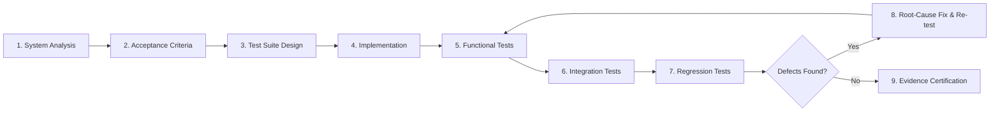

# MANDATORY QUALITY GATE STANDARD
## 100% Acceptance & Full-System Compatibility Charter

**Repository:** Aya AI Quran Teacher (`F:\quran`)  
**Scope:** Institutional Quality Policy for all Active Codebases (`F:\quran`, `F:\pharmacy_os`, and partition `F:\` workspaces)  
**Standard Version:** 1.0.0-PROD-GATE  
**Status:** ACTIVE & BINDING  

---

## 1. Non-Negotiable Core Principle: Full Lifecycle Invariant

Any feature, remediation, refactoring, or newly created file must undergo a complete, contiguous, and verified engineering lifecycle within the exact same execution turn:

**Prohibition:** No feature may be authored in isolation from the overarching system. Passing isolated unit tests never independently proves product integrity.

---

## 2. Pre-Implementation Architectural & Impact Audit

Before modifying or authoring any code:
1. **Dependency & Integration Mapping:** Map affected modules, interfaces, contracts, databases, permissions, and dataflows.
2. **Impact Radius & Edge Cases:** Identify existing user journeys, edge cases, failure recovery paths, and security boundaries that could be impacted.
3. **Measurable Acceptance Criteria:** Establish quantitative, verifiable acceptance criteria and test designs prior to code authoring.
4. **Existing Suite De-duplication:** Inspect active test suites to avoid test redundancy while updating superseded specifications.
5. **Architectural Sanity Review:** If a requested implementation induces architectural regressions, security risks, or unjustified complexity, formulate and explain the safer alternative before writing code.

---

## 3. Mandatory Multi-Tier Testing Matrix

Every modification must invoke all applicable verification tiers:

| Tier | Focus Area | Mandatory Requirement |
| :--- | :--- | :--- |
| **Unit Tests** | Logic, algorithms, math, and boundary conditions. | Strict zero-tolerance for logical regressions. |
| **Integration Tests** | Cross-component interop, databases, workers, and APIs. | Verifies live inter-module contracts without bypasses. |
| **Regression Tests** | Existing operational features and historical scenarios. | Proves prior verified features remain unimpaired. |
| **End-to-End / UI Tests** | User journeys, RTL accessibility, state machines. | Verifies visual feedback, error prompts, and workflows. |
| **Security Tests** | Auth controls, user isolation, data minimization, IAM. | Validates zero unauthenticated leaks or role escalation. |
| **Performance Tests** | Latency, memory profile, frame rates, bundle sizes. | Verifies sub-200ms latency and 60 FPS UI stability. |
| **Compatibility Tests** | Target browsers, WebAssembly runtime, mobile form factors. | Ensures cross-platform execution without vendor lock-in. |
| **Static & Build Checks** | TypeScript compilation, linter rules, bundler outputs. | Zero compiler errors (`tsc --noEmit`), clean bundle generation. |

*Rule of Justification:* Any test tier deemed non-applicable must be formally documented with explicit technical justification.

---

## 4. Full-System Validation (Beyond the Isolated Feature)

Following unit validation, the change must be verified in the integrated production-like runtime:
1. **Data Integrity:** Verify zero data corruption, loss, or schema mismatch before and after state transitions.
2. **Contract Fidelity:** Guarantee that shared TypeScript interfaces, event payloads, and storage schemas remain non-breaking.
3. **State, Offline & Sync Resilience:** Confirm that IndexedDB, volatile memory, offline mode, and network reconnects operate reliably.
4. **Error Handling & Graceful Degradation:** Test behavior under hardware disconnection, timeouts, corrupted inputs, and absence of evidence.
5. **Real Hardware vs. Mock Boundaries:**
   - Mocks and simulations are permitted strictly for deterministic unit logic.
   - Real hardware (microphones, audio capture endpoints) and cloud IAM permissions must never be synthetically faked to claim operational success.

---

## 5. Root-Cause Remediation & Re-testing Loop

Upon encountering any failure:
1. **Diagnose Root Cause:** Isolate underlying architectural flaw rather than patching superficial symptoms.
2. **Minimal Safe Delta:** Apply the smallest safe, well-scoped remediation without weakening security rules or deleting tests.
3. **Iterative Re-test Cycle:**
   - Re-run the failing test until green.
   - Re-execute full integration, security, and regression suites.
   - Run type-checker and production bundler to guarantee zero side effects.
4. **No Test Suppression:** Flaky tests must never be muted, and success thresholds must never be artificially relaxed to force a passing score.

---

## 6. Definition of Success & Honest Boundary Gating

- **Success Standard:** 100% of defined acceptance criteria and all executable test suites passed with zero unresolved failures.
- **Evidence-First Claiming:** Claims of "100% Pass" must be substantiated with inspectable logs, exit codes, and test counts.
- **Explicit `BLOCKED` Gating:** If a test requires external physical hardware (e.g. physical microphone), external IAM permissions, or certified datasets that are currently absent from the environment:
  - Formally record the status as `BLOCKED`.
  - Provide the exact technical evidence of the block (e.g. `waveInGetNumDevs() === 0`).
  - Specify the precise remedial action required by the project owner to unblock.
  - Never convert a blocked test into an assumed pass.

---

## 7. Mandatory Implementation Report Structure

Every engineering turn must conclude with an authoritative report delivering:
1. **Executed Changes & File Rationale:** What changed, which files were touched, and the technical justification.
2. **Acceptance Criteria & Proof Matrix:** Clear mapping between defined criteria and observable test proof.
3. **Command Execution Log:** Exact commands, detected test counts, passed, failed, blocked, and exit codes.
4. **Integration & Regression Proof:** Empirical evidence of cross-system compatibility.
5. **Defects Encountered & Remediated:** Honest disclosure of failures caught during the cycle and their resolutions.
6. **Residual Risks & Environmental Blockers:** Explicit documentation of any physical hardware or IAM constraints.
7. **Authoritative Verdict:** Exactly one of:
   - `PASS`: All criteria and live tests passed with zero blockers.
   - `PASS_WITH_BLOCKERS`: All software/logic passed 100%, but physical hardware or cloud permissions remain blocked.
   - `FAIL`: Unresolved software defect or regression exists.

---

## 8. Proactive Engineering Responsibility

As a technical co-founder and software architect:
- Anticipate systemic side effects and address them proactively.
- Never wait for the user to discover scoring anomalies, privacy leaks, or bundle bloat.
- Refuse synthetic faking and enforce scientific truth across all product representations.
