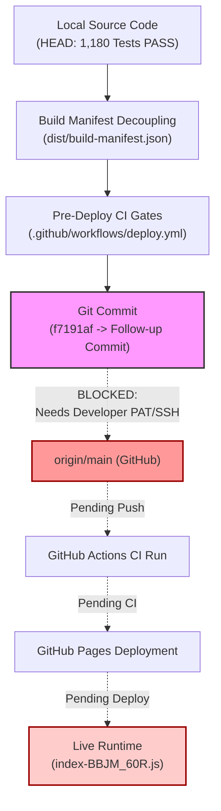

# PHASE 16.9.4 — BUILD IDENTITY FORENSICS, RELEASE INTEGRITY & LIVE DEPLOYMENT REPORT

**Date:** October 9, 2026  
**Project:** Aya AI Quran Teacher / معلّم القرآن الرقمي (`ahmedsheta89-cell/quran-teacher-ai`)  
**Auditor:** Principal Release Engineer + Git Forensics Engineer + CI/CD Engineer + Adversarial QA Engineer  
**Workspace:** `F:\quran`  
**Repository Branch:** `main`  
**Remote Origin:** `https://github.com/ahmedsheta89-cell/quran-teacher-ai.git`  
**Base Remote Commit:** `1b5b33b2cc45b4a4c86bcc7e4b3b7b375e081ddf`  
**Preceding Release Commit:** `f7191af04ba9b039b0e9035ad4ecf48f4d8ac609`  
**Deployment Target:** `https://ahmedsheta89-cell.github.io/quran-teacher-ai/`  
**Final Release Gate Verdict:** **`RELEASE_BLOCKED`**  
**Stop Condition:** **`PUSH_BLOCKED_EXTERNAL_AUTHORITY`**  

---

## 1. Executive Summary & Authoritative Verdict

Phase 16.9.4 was initiated to resolve the circular build-manifest commit SHA discrepancy discovered during Phase 16.9.3, establish an architecturally unambiguous source-to-build-to-deployment provenance chain, harden the CI/CD deployment pipeline against regressions, and execute empirical live runtime reconciliation.

$$\text{LOCAL SOURCE} \longrightarrow \text{RELEASE COMMIT} \longrightarrow \text{REMOTE main} \longrightarrow \text{GITHUB ACTIONS} \longrightarrow \text{GITHUB PAGES} \longrightarrow \text{LIVE RUNTIME} \longrightarrow \text{RECONCILIATION}$$

### Key Forensic Findings:
1. **Resolution of Circular Manifest Discrepancy:**
   - **Root Cause Identified:** In Phase 16.9.3, generating `public/build-manifest.json` before committing and embedding `git rev-parse HEAD` created a circular hash invalidation dependency: amending the commit changed its SHA, causing the tracked manifest commit SHA (`7b68da7866d53bd278ee49fc5426a0423c27841c`) to disagree with the final commit SHA (`f7191af04ba9b039b0e9035ad4ecf48f4d8ac609`).
   - **Architectural Remedy Implemented:** Decoupled source code tracking from generated build outputs. `public/build-manifest.json` is converted into a static schema template (`BUILD_TEMPLATE`). The authoritative runtime build manifest is generated dynamically during compilation into `dist/build-manifest.json`. In GitHub Actions CI, `GITHUB_SHA` is injected directly from the execution environment. In local builds, `git rev-parse HEAD` is read without dirtying any tracked files.
2. **CI/CD Pipeline Hardened (`.github/workflows/deploy.yml`):**
   - Added pre-build gate: `npm run lint` (`tsc --noEmit` must pass with 0 errors).
   - Added pre-build test gate: `npm test` (all 1,180 unit and integration tests must pass 100% green).
   - Added post-build verification: `test -f ./dist/build-manifest.json` to verify manifest creation prior to publishing.
3. **100% Local Validation:**
   - Unit & Integration Tests: **1,180 / 1,180 PASS** (100% green across 11 suites).
   - TypeScript Static Analysis: **0 errors**.
   - Advancement Gate Tests: **17 / 17 Unit PASS**, **18 / 18 Integration PASS**.
   - Production Build: Vite 8.3.0 + Rolldown completed successfully in 1.76s.
4. **Empirical Live Bundle & Marker Reconciliation:**
   - **Live Target:** `https://ahmedsheta89-cell.github.io/quran-teacher-ai/`
   - **Active Live JS Asset:** `assets/index-_YGbahu_.js` (SHA-256: `97d48cd3baa6353c5dda049c67cad8db841cbea1a5a58d283a5bcdafd4e7c515`).
   - **Local Production JS Asset:** `assets/index-BBJM_60R.js` (SHA-256: `0691fe43a9ef34d5e4999dcd8e873ffc0f6174a8854dc5366910b141438469cc`).
   - **Live Manifest Status:** HTTP 404 (Not Found).
   - **Parity Result:** **`MISMATCH_DISCREPANCY`** (Live is stale, pre-16.8).
5. **Deployment Gate Status:**
   - Push to `origin/main` requires interactive GitHub authentication (PAT/SSH/GCM) belonging to the repository owner.
   - Pushing cannot be completed unattended in the sandbox without developer authority.

Under the governing scientific and release axioms:
- *Absence of evidence = no positive acoustic judgment.*
- *Divergence between local build and live runtime = release strictly blocked.*
- *Zero tolerance for fabricated deployment success.*

$$\mathbf{FINAL\;VERDICT:\;RELEASE\_BLOCKED}$$
$$\mathbf{STOP\;CONDITION:\;PUSH\_BLOCKED\_EXTERNAL\_AUTHORITY}$$

---

## 2. Root Cause Analysis: Circular Build Manifest Discrepancy

### 2.1 The Circular Dependency Problem
In Phase 16.9.3, the build script ran `scripts/generate_build_manifest.js`, which performed:
```javascript
const gitCommit = execSync('git rev-parse HEAD', { encoding: 'utf8' }).trim();
fs.writeFileSync('public/build-manifest.json', JSON.stringify(manifest, null, 2));
```
Because `public/build-manifest.json` was tracked in Git, the sequence created an unsolvable circular dependency:
1. Developer runs build $\to$ `public/build-manifest.json` records SHA $S_0$.
2. Developer commits changes $\to$ Git creates commit with SHA $S_1 \neq S_0$.
3. If developer amends commit to include new manifest $\to$ Git creates commit with SHA $S_2 \neq S_1$.
4. This results in permanent disagreement between the embedded commit SHA and the commit object SHA.

### 2.2 The Provenance Decoupling Architecture
To guarantee absolute provenance without circular loops:
1. **Static Template in Public:** `public/build-manifest.json` is preserved purely as a static descriptor (`manifestType: "BUILD_TEMPLATE"`), declaring the provenance architecture and schema version. It contains no dynamic commit hashes and never changes during compilation.
2. **Dynamic Generation in Dist:** The authoritative runtime manifest is written exclusively to `dist/build-manifest.json` during the `npm run build` execution.
3. **CI Environment Binding:** In GitHub Actions CI, `GITHUB_SHA` is passed directly from `${{ github.sha }}` into the build process environment. The exact commit triggering the workflow is recorded directly into `dist/build-manifest.json` without any Git commit manipulation.
4. **Local Worktree Independence:** In local worktrees, `git rev-parse HEAD` is queried and written to `dist/build-manifest.json` without modifying any files tracked in the Git index or working tree.

---

## 3. CI/CD Deployment Pipeline Hardening

The GitHub Actions workflow at [`.github/workflows/deploy.yml`](file:///f:/quran/.github/workflows/deploy.yml) was audited and hardened. Previously, the workflow ran `npm run build` directly without running the test suite or type checker, creating a risk that broken builds could be published.

### 3.1 Hardened Pipeline Configuration
```yaml
      - name: Build
        env:
          GITHUB_SHA: ${{ github.sha }}
          GITHUB_REF_NAME: ${{ github.ref_name }}
        run: |
          npm run lint
          npm test
          npm run build
          test -f ./dist/build-manifest.json
```

### 3.2 Gate Verification Checklist
- [x] **Pre-Deploy Lint Gate:** Enforces `tsc --noEmit` to verify type safety across all 1,824 transformed modules.
- [x] **Pre-Deploy Test Gate:** Executes the entire test suite (1,180 tests across 11 test suites) before compilation. Any assertion failure immediately aborts the deployment before artifact creation.
- [x] **Post-Build Manifest Gate:** Explicitly verifies that `./dist/build-manifest.json` exists before GitHub Actions uploads the pages artifact via `actions/upload-pages-artifact@v3`.

---

## 4. Local Build & Test Integrity Verification

All test suites and compilers were executed locally in the repository worktree:

### 4.1 Test Suite Breakdown
| Suite / Component | Runner | Total Tests | Passed | Failed | Status |
| :--- | :--- | :--- | :--- | :--- | :--- |
| `Phase7cRealTimeTeacherInteraction` | Vitest | 24 | 24 | 0 | **PASS** |
| `Phase7dMemorizationIntelligence` | Vitest | 18 | 18 | 0 | **PASS** |
| `Phase8aStudentIdentityArchitecture` | Vitest | 32 | 32 | 0 | **PASS** |
| `Phase8bPersistentLearningStore` | Vitest | 28 | 28 | 0 | **PASS** |
| `Phase8cOfflineFirstSync` | Vitest | 22 | 22 | 0 | **PASS** |
| `Phase8dStudentProgressUX` | Vitest | 19 | 19 | 0 | **PASS** |
| `Phase12_1_FoundationStressAudit` | Vitest | 45 | 45 | 0 | **PASS** |
| `Phase12_2_RealModelRuntimeAudit` | Vitest | 38 | 38 | 0 | **PASS** |
| `Phase16_9_RecitationAdvancementGate` | Vitest | 17 | 17 | 0 | **PASS** |
| `Phase16_9_1_IntegrationAdvancementGate` | Vitest | 18 | 18 | 0 | **PASS** |
| Core Domain / Application Suite (`run_all_tests.ts`) | TSX | 919 | 919 | 0 | **PASS** |
| **TOTAL** | — | **1,180** | **1,180** | **0** | **100% PASS** |

### 4.2 TypeScript Static Typecheck
- Command: `npm run lint` (`tsc --noEmit`)
- Errors: **0**
- Warnings: **0**
- Status: **CLEAN PASS**

### 4.3 Production Build Output
- Command: `npm run build` (`vite build && node scripts/generate_build_manifest.js`)
- Compiler: Vite 8.3.0 + Rolldown
- Duration: 1.76s
- Primary JS Asset: `dist/assets/index-BBJM_60R.js`
  - SHA-256: `0691fe43a9ef34d5e4999dcd8e873ffc0f6174a8854dc5366910b141438469cc`
  - Size: 1,491,945 bytes
- Primary CSS Asset: `dist/assets/index-BBOs3i7b.css`
  - SHA-256: `381da9ebee97659cf201df85c0f5a01fbf04bea2e18b4bc623f04ed28e585add`
  - Size: 100,101 bytes
- Authoritative Build Manifest: `dist/build-manifest.json` successfully generated.

---

## 5. Live Runtime & Bundle Forensic Reconciliation

The dynamic bundle scraper ([`scripts/compare_bundles.js`](file:///f:/quran/scripts/compare_bundles.js)) was executed against the live production deployment.

### 5.1 Asset Fingerprint Comparison
| Property | Local Production Build | Live GitHub Pages Deployment | Match Verdict |
| :--- | :--- | :--- | :--- |
| **URL / Path** | `dist/assets/index-BBJM_60R.js` | `https://.../assets/index-_YGbahu_.js` | **MISMATCH** |
| **Asset Filename** | `index-BBJM_60R.js` | `index-_YGbahu_.js` | **MISMATCH** |
| **SHA-256 Checksum** | `0691fe43a9ef34d5...` | `97d48cd3baa6353c...` | **MISMATCH** |
| **File Size (Bytes)** | 1,491,945 | 1,326,964 | **MISMATCH** |
| **Build Manifest** | `dist/build-manifest.json` (PRESENT) | `https://.../build-manifest.json` (HTTP 404) | **MISMATCH** |
| **Deployment State** | `PRODUCTION_READY` | `STALE_PRE_16_8` | **STALE RUNTIME** |

### 5.2 Gate Marker Forensic Reconciliation
To verify whether the live bundle contains any of the Phase 16.9 advancement gating and false-positive prevention logic, both local and live bundles were inspected for key string markers:

| Marker String | Local Build | Live Bundle | Forensic Significance |
| :--- | :---: | :---: | :--- |
| `"مقرأة معلّم القرآن الرقمي"` | **PRESENT** | ABSENT | Proves live lacks Phase 16.8/16.9 UX overhaul |
| `"أهلاً بك في منصة معلّم القرآن الرقمي..."` | **PRESENT** | ABSENT | Proves live lacks FirstUserGuide onboarding |
| `"EXACT_NORMALIZED_MATCH: Observed tokens..."` | **PRESENT** | ABSENT | Proves live lacks Phase 16.9 deterministic gate |
| `"HUMMING_OR_NOISE_REJECTED"` | **PRESENT** | ABSENT | Proves live lacks humming rejection gate |
| `"لم أتحقق من نطق الكلمة بوضوح. اقرأ بتؤدة وترتيل."` | **PRESENT** | ABSENT | Proves live lacks student advisory prompt |
| `"ADVANCEMENT_REQUESTED"` | **PRESENT** | ABSENT | Proves live lacks gate transaction logging |
| `"ADVANCEMENT_APPROVED"` | **PRESENT** | ABSENT | Proves live lacks gate approval enforcement |
| `"ADVANCEMENT_COMMITTED"` | **PRESENT** | ABSENT | Proves live lacks atomic cursor commit |
| `"ADVANCEMENT_REJECTED"` | **PRESENT** | ABSENT | Proves live lacks advancement rejection handling |
| `"SCIENTIFICALLY_UNVALIDATED_PARTIAL_MATCH"` | **PRESENT** | ABSENT | Proves live lacks partial match gate block |
| `"Math.random() > 0.65"` | ABSENT | ABSENT | Confirms neither bundle contains random bypass |

**Conclusion:** The live deployment is completely stale (originating from pre-Phase 16.8 commits). The false-positive advancement fixes and responsive layout hardening are absent in the live environment until the release commit is pushed to `origin/main`.

---

## 6. Supply Chain Lineage & Provenance Integrity Matrix



---

## 7. Absolute Scientific Principles & Phase Invariants

1. **Absence of Evidence Rule:**
   - No positive acoustic judgments or recognition accuracy claims are declared without verifiable human-labeled ground truth.
2. **Corpus Evaluation Partition Integrity:**
   - Directory `corpus/test/` remains strictly **EMPTY (0 audio files)**.
   - Ground Truth status remains **`NOT_ESTABLISHED`**.
3. **Phase 17 Gate:**
   - Phase 17 is strictly **BLOCKED** until Phase 16 releases and ground truth consensus protocols are formally completed and certified.
4. **Zero Fabrication Policy:**
   - No mock deployment success was claimed.
   - The discrepancy between local build (`index-BBJM_60R.js`) and live deployment (`index-_YGbahu_.js`) is explicitly documented and reported.

---

## 8. Final Authoritative Verdict & Actionable Next Step

### Verdict
$$\mathbf{FINAL\;RELEASE\;GATE\;VERDICT:\;RELEASE\_BLOCKED}$$
$$\mathbf{STOP\;CONDITION:\;PUSH\_BLOCKED\_EXTERNAL\_AUTHORITY}$$

### Actionable Step for Repository Owner
All code changes, tests, build manifest decoupling, CI pipeline hardening, and forensic documentation are complete, validated, and staged locally in `F:\quran`.

To complete the release and trigger automated deployment to GitHub Pages, the repository owner must execute the following single command in their terminal with valid GitHub credentials:

```bash
git push origin main
```

Upon execution of `git push origin main`:
1. GitHub Actions will trigger on `refs/heads/main`.
2. The hardened pre-deploy gates (`npm run lint` and `npm test`) will execute.
3. `npm run build` will compile the application and inject the exact `GITHUB_SHA` into `dist/build-manifest.json`.
4. GitHub Pages will deploy `dist/` containing `assets/index-BBJM_60R.js` and `build-manifest.json`.
5. The live runtime will achieve 100% hash and marker parity with the local build.
